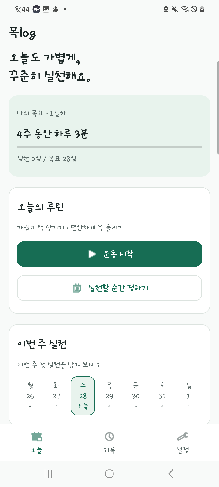
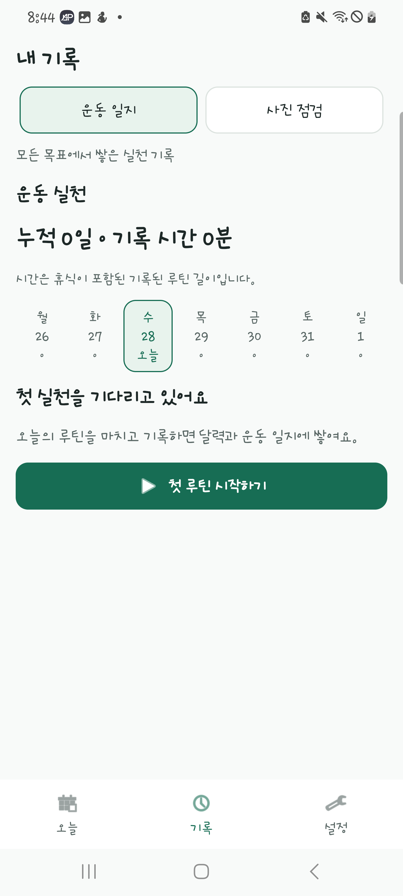

# 목log · 5조 중간 점검 준비 자료

점검 예정: **2026년 11월 9일(월)**

작성·구현 확인 기준: **2026년 10월 28일**

11월 9일 점검을 준비하기 위해 실제 개발 기록을 기간별 단계로 정리했다. 이후 작업은 예정으로 구분했다.

## 1. 현재 진행 상황

목log는 짧은 운동을 일상에 연결하고, 실천 기록과 주기적인 옆모습 사진 점검을 함께 관리하는 Android 앱이다. 현재 스마트폰에 설치해 주요 화면과 타이머, 기록 조회, 카메라 연결을 확인했다. Google Play에는 아직 등록하지 않았다.

**목표 설정 → 운동 안내·타이머 → 실제 수행 확인·일지 → 주기적인 사진 점검·기록 비교**

| 구분 | 현재 결과 | 남은 확인 |
| --- | --- | --- |
| 운동 습관 | 2주/4주·하루 3분/5분 목표, 실천 약속, 주간 달력, 실제 실천일 기준 진행률 | 여러 날 사용·날짜 변경 |
| 운동 안내 | 일반 운동 2종, 자체 참고 그림과 순서 재생, 설명·주의사항·타이머 | 콘텐츠 최종 검토, 외부 영상 사용 여부·권한 |
| 운동 일지 | 날짜·루틴 시간·선택형 한 줄 메모, 메모 수정, 누적 기록, 완료 피드백 | 실제 완료·메모 편집의 추가 사용성 |
| 사진 점검 | 귀 후보, 사용자의 귀·C7 확인, 사진 3장의 평균, 같은 조건 기록 비교 | 반복 실촬영·기준점 대조 |
| 촬영 보조 | 구도·수평 안내, 자동 촬영 조건, 소리·진동, 중단 처리 | 실제 옆모습에서의 자동 촬영·알림 체감 |
| 화면 | Figma 기반 스타일 반영, 공통 버튼, 폰·태블릿 폭과 큰 글꼴 대응 | 기기별 최종 점검 |
| 출시 준비 | 목log 이름·로고, 별도 배포 구성, APK·AAB, 스토어 자료·개인정보 초안 | 개발자 계정·공개 운영 정보·최종 서명·테스트·심사 |

여기서 '구현'은 코드가 있다는 뜻이고, '확인'은 실제로 수행한 검사 범위를 뜻한다. 사람의 자세를 정확히 판정했다거나 운동 효과가 증명됐다는 뜻은 아니다.

## 2. 처음의 구상과 현재의 변화

| 관점 | 처음 | 현재 |
| --- | --- | --- |
| 중심 기능 | 실시간 화면에서 귀와 어깨를 연결해 각도 표시 | 운동을 꾸준히 기록하고 일정 간격으로 사진 점검 |
| 측정 기준 | 검출된 귀·어깨 후보 | 사용자가 확인한 귀의 이주와 사전 확인한 C7 표식 |
| 입력 방식 | 계속 변하는 영상 프레임 | 시간 간격을 둔 사진 3장과 사람의 기준점 확인 |
| 결과 표현 | 화면 위 점·선·각도 중심 | 사진별 각도·평균·촬영 조건·과거 기록 비교 |
| 사용자 경험 | 개발용 검출 실험 화면 | 목표·오늘·운동·사진 점검·일지·설정으로 연결된 앱 |
| 제품 목표 | 측정이 가능한지 확인 | 운동 습관을 지원하는 목log의 독립 실행과 Play 출시 준비 |

### 화면 변화

<table>
  <tr><th>초기 앱 화면 참고</th><th>현재 오늘 화면</th><th>현재 운동 일지</th></tr>
  <tr>
    <td></td>
    <td></td>
    <td></td>
  </tr>
</table>

왼쪽은 10월 4일 당시 코드를 재구성한 참고 이미지이고, 가운데·오른쪽은 10월 28일 실제 앱 화면이다. 일지 이미지는 당시 실천 0일 상태에서 촬영한 UI이며 운동 실험 결과나 효과를 나타내지 않는다. 개인 촬영 사진은 포함하지 않았다.

## 3. 기간별 개발 과정

| 기간 | 단계 | 진행 내용과 다음 단계로 이어진 이유 |
| --- | --- | --- |
| 9/13~9/29 | 개발 기반·검출 실험 | 개발 규칙과 환경을 정하고 귀·어깨 점, 연결선, 각도를 표시했다. 측면에서의 좌표 차이·흔들림·좌우 대응을 확인하며 실시간 값만으로 일관된 측정이 어렵다는 문제를 정리했다. |
| 9/30~10/4 | 사진 점검·기본 앱 구성 | 사진 3장, 귀·C7 직접 확인, 계산·저장·재실행 흐름을 만들고 갤탭에서 한 사례를 확인했다. 목표·운동·기록을 연결하고 조원 공유 문서와 UI 지침을 정리했다. |
| 10/5~10/11 | 화면 설계·프로토타입 | 진행 보고 자료와 디자인 시안을 검토하고, Figma 공통 스타일·컴포넌트·Android 프로토타입을 정리했다. 기능을 사용하는 순서와 화면별 역할을 구체화했다. |
| 10/12~10/18 | 실제 앱 UI 적용 | 시안을 Java 앱에 반영하고 버튼·카드·탐색·화면 폭·큰 글꼴 대응을 보완했다. 갤탭에서 UI 검사와 가로·세로 화면을 확인했다. |
| 10/19~10/23 | 촬영 흐름·기록 계산 보완 | 구도·수평 대기와 자동 촬영, 알림·취소 처리를 추가했다. 대표값을 평균으로 통일하면서 원래 값 보존 검사를 보강했고, 검사 저장소 격리 문제도 수정했다. |
| 10/24~10/28 | 습관 기능·스마트폰·출시 준비 | 목log 이름·로고와 출시 구성을 정리했다. 주간 달력·실천 약속·메모 일지·각도 참고 안내를 추가하고 S20 Ultra에서 검사했다. 스토어 자료·정책 초안과 남은 제출 조건을 정리했다. |

세부 작업·검증 날짜와 실행 결과는 문서 마지막의 원본 기록에서 확인할 수 있다.

## 4. 중간에 확인한 이슈와 대응

| 이슈 | 왜 문제였는가 | 대응 | 현재 남은 한계 |
| --- | --- | --- | --- |
| 귀 점이 볼·코 쪽에 표시됨 | 검출 도구의 좌우 이름과 화면 반전이 실제 보이는 신체 쪽과 항상 같지 않음 | 같은 사진·반전 사진 재현으로 좌우 대응을 확인하고, 귀 후보는 사용자가 다시 확인하도록 구성 | 모든 사람·조명·측면에서 정확하다는 검증은 아님 |
| 실시간 점과 각도의 흔들림 | 프레임 변화와 잘못된 후보가 각도를 계속 바꿈 | 프레임 처리와 후보 선택을 보완한 뒤 제품은 사진 3장 확인 흐름으로 전환 | 반복 촬영과 실제 기준점 대조 필요 |
| 어깨점을 C7로 볼 수 있는가 | 어깨와 목 아래 기준점은 다른 위치이며 ML Kit에 C7 검출점이 없음 | 어깨를 임의로 이동해 대체하지 않고 사전 확인한 C7 표식을 사용자가 지정 | 실제 C7 위치를 확인하는 절차 필요 |
| 촬영을 의식한 자세 변경 | 일부러 턱을 당기면 평소 자세와 달라질 수 있음 | 촬영 중 미리보기 가림, 시간 간격을 둔 3장, 촬영 후 결과 확인 | 의도적 자세 변경을 완전히 판별하지는 못함 |
| 자동 촬영·수평 안내 부족 | 사용자가 언제 준비됐고 언제 촬영되는지 알기 어려움 | 구도·수평 유지 조건, 이탈 초기화, 안내음·진동·수동 촬영 경로 추가 | 실제 촬영·무음·기기별 체감 점검 |
| 평균 전환과 기존 기록 보존 | 화면 문구만 바꾸면 저장·비교 방식이 달라지고 예전 값을 잃을 수 있음 | 원래 사진별 값·중앙값 보존, 평균 추가·비교 통일. 메모 추가 때도 이전 DB 업그레이드 검사 | 실제 여러 날 사용 추가 확인 |
| 자동 검사가 실제 기록 저장소에 접근 | 10/23 기존 검사에서 실제 기록 DB에 삭제 동작이 실행됨 | 사용자 고지, 검사 전용 DB·설정 격리, 실제 열린 경로 확인, 백업·보존 검사 보강 | 당시 삭제 전 백업이 없어 과거 기록 복구를 보장하지 못함 |
| 활성 버튼이 회색으로 보임 | 버튼이 눌릴 수 있어도 비활성처럼 보여 행동이 불명확함 | 공통 버튼의 배경·색상 적용 보완, 실제 화면에서 활성·비활성·스타일 전환 검사 | 사용 라이브러리 갱신 시 재확인 |
| 개발 샘플과 출시 앱의 구분 | 검출 예제·불필요한 권한과 SDK가 제품에 섞일 수 있음 | 출시 모듈과 설치 ID를 분리하고 제품 코드만 공유. 샘플 메뉴·불필요 SDK 제외 | 최종 소유자 서명·설치/기록 보존 경로 확정 |

기록 보호 문제는 해결 과정에서 숨기지 않고 원인·대응·복구 한계를 함께 남겼다. 수정 후 검사가 통과했다는 것과 과거 데이터가 복구됐다는 것은 다르다.

## 5. 검증 결과

### 기존 사람 대상 사진 점검

9월 30일 갤럭시 탭에서 한 사용자의 서 있는 왼쪽 옆모습을 전면 카메라로 촬영하고, 사용자가 귀·C7 위치를 확인했다.

| 사진 1 | 사진 2 | 사진 3 | 당시 대표값 | 사진 사이 범위 |
| --- | --- | --- | --- | --- |
| 52.5° | 55.4° | 55.7° | 중앙값 55.4° | 3.2° |

이후 제품 대표값은 평균으로 바꿨다. 위 세 값을 같은 방식으로 다시 계산하면 약 54.53°이며 **새로운 실험이나 자세 변화 결과가 아니다.** 사진 사이의 3.2° 역시 실제 자세와의 오차를 뜻하지 않는다.

### 현재 소프트웨어·기기 확인

| 확인 | 결과 | 의미 |
| --- | --- | --- |
| 독립 계산·촬영 조건·주간 집계 | 57개 통과 | 알려진 입력과 예외 조건의 동작 확인 |
| S20 Ultra 내부 검사 | 12개 통과 | UI·격리 기록·DB 업그레이드·가이드·브랜드·귀 대응·버튼 확인 |
| 앱 빌드 | 개발·출시 APK, AAB, lintRelease 성공 | 설치/배포 후보 파일 생성 가능 |
| 스마트폰 조작 | 첫 안내·목표·운동·타이머·기록·설정·회전·카메라 연결 | 주요 사용 경로 확인 |
| 습관 흐름 | 주간 달력·기록 탭·실천 약속 재실행 보존, 3분 타이머 종료 | 기록과 화면 흐름 확인 |
| 배포 정적 검사 | 대상 API 36, 64비트 ELF 16KB 정렬, APK 정렬 확인 | 최신 Android·16KB 실제 실행을 대체하지 않음 |

57개·12개는 **검사 항목 수**이며 사람 대상 실험 인원이 아니다. 현재 결과로 질환 진단, 운동 효과, 모든 기기에서의 정확도를 주장하지 않는다.

## 6. 11월 9일 점검에 제시할 자료

| 자료 | 보여줄 사실 |
| --- | --- |
| 기간별 개발 과정 | 실시간 검출 실험에서 사진 점검·운동 습관 앱으로 범위를 구체화한 과정 |
| 초기/현재 화면 | Figma 설계와 실제 코드 반영, 오늘·운동·일지의 역할 변화 |
| 핵심 시연 | 목표 → 운동 안내 → 타이머 → 일지, 사진 점검 준비·기준점 확인 흐름 |
| 이슈와 대응 | 귀 좌표, 기준점 구분, 촬영 보조, 기록 보호, 버튼 상태 문제 |
| 실제 검사 결과 | 사람 대상 한 사례와 프로그램 검사를 구분한 수치·한계 |
| 남은 일정 | 운동 콘텐츠·최종 UI·실사용 검증·출시 제출의 단계와 완료 기준 |

실제 수행하지 않은 사진 측정·운동 완료를 시연용으로 저장하지 않는다. 점검 당일의 앱 버전·영상·검증표는 실제 상태로 갱신한다.

## 7. 남은 일정과 근거

남은 일정은 [11월 9일 점검~12월 7일 마감 계획](ROADMAP_2026-11-09_TO_12-07.md)을 기준으로 한다. 11월 8일까지 신규 개발 일정은 비워 두고, 11월 9일 점검 이후 운동 콘텐츠·UI 마감, 실사용 검증, 출시 제출 준비 순서로 진행한다.

- [초기 실험 노트](../android/vision-quickstart/MEASUREMENT_NOTES.md)
- [9월 30일 결과를 정리한 팀 공유 자료](../TEAM_PROGRESS_2026-10-03.md)
- [Figma UI의 실제 앱 반영](ANDROID_UI_2026-10-18.md)
- [촬영·평균값·기록 격리 문제](CAPTURE_WORKLOG_2026-10-23.md)
- [습관·일지 보완](HABIT_REFINEMENT_2026-10-28.md)
- [현재 출시 후보 검증](release/VERIFICATION_2026-10-28.md)
- [출시 준비와 소유자 작업](release/README.md)

개발 기간은 저장소의 9월 13일 이후 변경 기록과 위 문서를 대조해 묶었다. 9/30 e583ccf, 10/11 2a2ad69, 10/18 9a2f50f, 10/23 1d7a0e6 등의 구현·설계 기록이 주요 기준이다.
