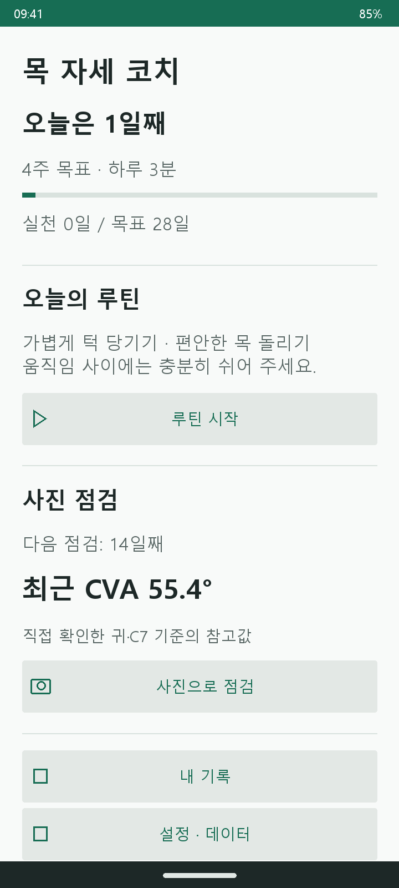
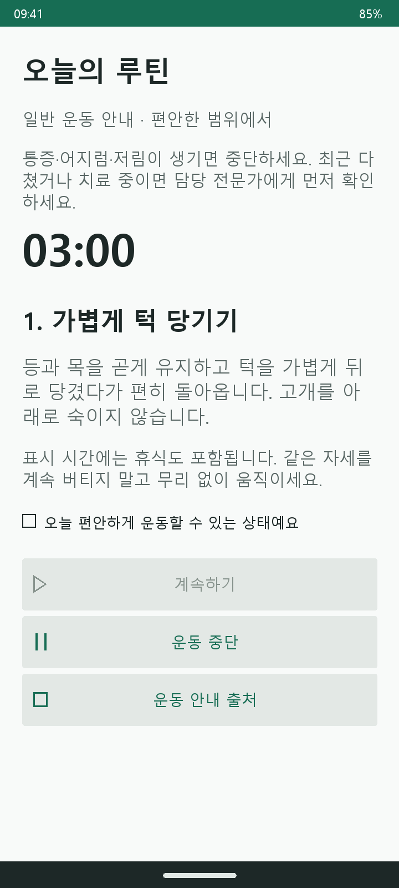
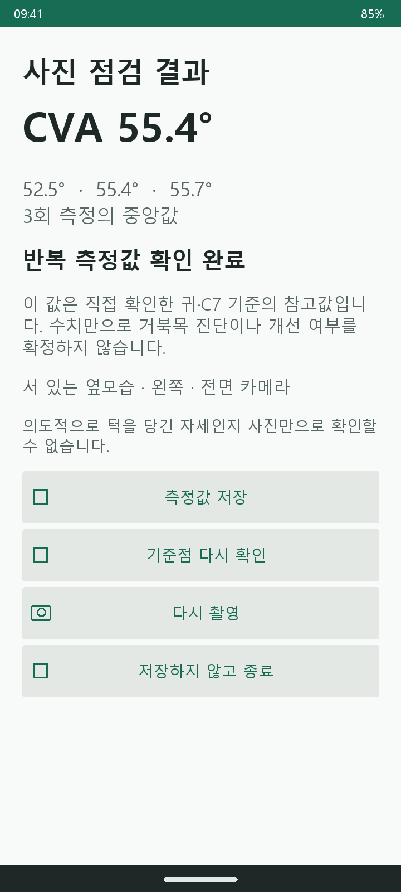

# 목 자세 코치 개발 진행 보고서

캡스톤디자인 5조 | 작성일 2026-10-10 | 실제 촬영 결과 기준 2026-09-30

## 1. 현재 도달한 단계

운동 습관을 기록하고 일정 간격으로 옆모습 사진을 점검하는 Android 앱을 구현했습니다. 갤럭시 탭에서 사진 3장 촬영, 귀·C7 기준점 확인, 각도 계산, 저장과 재실행 후 기록 유지까지 확인했습니다. 현재는 개발용 앱이며 측정 정확도, 운동 효과, 여러 스마트폰에서의 사용성은 추가로 검증해야 합니다.

### 서비스 흐름

목표 설정 → 첫 사진 점검 → 일반 운동 안내와 실천 기록 → 중간·마지막 사진 점검 → 같은 촬영 조건의 이전 수치와 비교.

ML Kit은 귀 후보를 제안합니다. 사용자가 실제 귀의 이주와 미리 위치를 확인한 C7 표식을 지정하며, 앱은 두 점으로 각도를 계산합니다. AI가 C7을 자동 검출하거나 회복 기간을 예측하는 기능은 없습니다.

### 상태를 읽는 기준

| 상태 | 의미 |
| --- | --- |
| 확인 완료 | 기록된 실제 기기 시험 또는 해당 자동 검사에서 동작 확인 |
| 구현·검증 필요 | 코드가 있으나 실제 사용 조건을 모두 확인하지 못함 |
| 미구현·예정 | 현재 앱에 없으며 후속 작업으로 계획 |
| 범위 제외 | 원래 계획에 있었지만 현재 제품 범위에서 제외 |

### 핵심 진행 현황

| 항목 | 상태 | 현재 근거 |
| --- | --- | --- |
| 사진 점검·각도 계산 | 확인 완료 | 갤탭 전면·왼쪽 사진 3장과 사용자 기준점 확인 |
| 측정값 저장·재실행 | 확인 완료 | 종료 후에도 세 각도와 촬영 조건 유지 |
| 운동 목표·타이머·실천 기록 | 구현·검증 필요 | 목표 선택, 타이머, 실제 수행 확인 후 저장 코드 |
| 촬영 예외·다른 기기 | 구현·검증 필요 | 권한·중단 처리 코드 있음, S20 Ultra 시험 남음 |
| 최종 UI·운동 영상과 이미지 | 미구현·예정 | 디자인 및 콘텐츠 전달·검토 후 반영 |
| 측정 신뢰도·스토어 출시 | 미검증·미출시 | 기준값 대조와 배포 준비가 남음 |

이번 보고서는 코드를 읽고 기존 결과를 대조해 작성했습니다. 10월 10일에 새 사람 대상 실험이나 실기기 검사를 수행한 것은 아닙니다.

<!-- PAGEBREAK -->

## 2. 날짜별 작업 기록

코드 반영 날짜는 Git 커밋을, 실험 날짜는 당시 기록을 기준으로 구분했습니다. 문서 작성과 앱 기능 개발을 같은 성과로 중복 집계하지 않습니다.

| 날짜 | 수행한 작업 | 결과·근거 |
| --- | --- | --- |
| 09.13 | 프로젝트 설명과 Git 컨벤션 정리 | 한국어 README·AGENTS, b38d785 등 |
| 09.14 | Gradle 실행 옵션 수정, 검출점 표시 | 빌드 문제 수정 및 랜드마크 시각화, 32e7b9c·441d3b9 |
| 09.21 | 귀·어깨 표시선 흔들림 보정 실험 | 실시간 검출 실험 변경, 955be49. 정확도 확보 완료를 뜻하지 않음 |
| 09.25 실험 기록 | 귀 후보가 볼·코에 표시되는 사례와 프레임 처리 조사 | 기존 공유 보고서의 재현·수정 기록. 관련 코드 커밋은 09.30 |
| 09.30 | 사진 점검·운동 습관 중심 앱 구현 | 목표·루틴·사진·결과·이력 연결, e583ccf |
| 09.30 | 귀 후보·프레임 처리 보정 반영 | 좌우 연결 및 입력 프레임 처리 수정, 3e9daae |
| 09.30 | 갤탭 촬영·저장·재실행 확인 | 사진 3장, 중앙값 55.4°, 측정 기록 유지 |
| 10.03 | 공유 보고서·클래스 역할·아키텍처 문서 | 0157c11·f836ad6·c77755c, dev 병합 d451512 |
| 10.04 | UI 디자인 담당자 지침서 작성 | 스타일 보드와 대표 화면 요청, 코드 기반 참고 화면, f6262e1 |
| 10.05 | 원래 필수 기능 대비 진행률 산정 | 대화에서 9개 기능을 평가해 61.1% 산정. 기능 추가 작업은 아님 |
| 10.10 | 코드 대조 및 진행 보고서 재구성 | 기능 상태, 클래스 연결, 실험 결과, 일정 칸반 정리 |

### 기존 검출 실험에서 얻은 결론

귀·어깨 후보를 자동으로 잇는 실험에서는 측면 검출과 기준점 위치가 불안정했습니다. 현재 제품은 사진을 찍은 뒤 귀 후보를 확인하고 C7 표식을 직접 지정하도록 바꿨습니다. 어깨점을 임의로 낮춘 위치를 C7으로 간주하지 않습니다.

### 자료 기준

작성 전 확인한 작업본은 docs/ui-design-brief 브랜치의 561f396입니다. 기존 실험 코드는 보존되어 있지만, 현재 사진 점검 결과를 만드는 경로와 구분합니다. 기존 Windows 작업본과 OlThing은 이 보고서 대상이 아닙니다.

<!-- PAGEBREAK -->

## 3. 코드로 확인한 기능: 운동과 기록

### 목표와 오늘 화면

PostureCoachActivity.setup()에서 2주/4주와 하루 3분/5분을 선택합니다. PostureStore.createPlan()은 목표 ID, 시작 날짜와 설정을 저장합니다. home()은 경과 일수, 실천 날짜 수와 다음 사진 점검 시점을 표시합니다. 사진 점검은 시작, 전체 기간의 중간, 마지막 시점을 안내합니다.

### 운동 안내와 실제 수행 확인

routine()은 일반 운동 설명과 휴식 포함 타이머를 제공합니다. 현재 동작은 가볍게 턱 당기기와 편안한 목 돌리기입니다. 사용자가 운동 가능한 상태를 확인하면 타이머를 시작할 수 있습니다. 타이머 종료 후 실제로 수행했는지 다시 확인하고, 동의했을 때만 실천 기록을 남깁니다. 카메라가 운동 수행 여부를 자동 판정하지 않습니다.

앱이 화면에서 벗어나면 onPause()에서 타이머를 일시정지합니다. 타이머 기능은 구현했지만 실제 루틴 완료와 날짜 변경을 포함한 장기 사용 시험은 남아 있습니다.

### 저장과 기록 비교

| 대상 | 코드의 처리 | 남은 확인 |
| --- | --- | --- |
| 목표 | SharedPreferences에 기간·시간·시작일·목표 ID 저장 | 새로운 목표를 반복 설정하는 사용 흐름 |
| 실천 기록 | SQLite practice에 목표·날짜·시간 저장 | 실제 운동 완료 및 다음 날 표시 |
| 하루 중복 | 목표 ID와 날짜를 기본키로 사용, 중복 삽입 무시 | 여러 화면 전환을 포함한 실제 사용 |
| 측정 기록 | measurement에 세 각도·중앙값·시각·조건 저장 | 다양한 촬영 조건별 이력 표시 |
| 이전 값 비교 | protocol 문자열이 같은 이전 기록과 차이 표시 | 조건을 실제로 동일하게 유지하는 촬영 절차 |
| 삭제 | 개별 측정 삭제 및 전체 기록 삭제 제공 | 사용자 확인 문구와 재시작 흐름 |

현재 protocol은 서서 촬영하는 방식의 버전, 선택한 좌우, 전후면 카메라를 구분합니다. 문자열이 같다고 실제 거리·조명·몸 방향까지 일치한다고 보장하지는 않습니다.

### 앞으로 보완할 저장 부분

현재 DB 버전은 1이며 onUpgrade()는 지원하지 않는 변경에 예외를 발생시킵니다. 출시 후 DB 구조를 변경하려면 기존 기록을 보존하는 이전 로직이 필요합니다. 기기 간 동기화와 백업 복원은 구현하지 않았습니다.

코드 근거: PostureCoachActivity.java의 setup·home·routine·history, PostureStore.java의 createPlan·finishPractice·saveMeasurement·onUpgrade.

<!-- PAGEBREAK -->

## 4. 코드로 확인한 기능: 사진 점검

| 단계 | 실제 구현 내용 |
| --- | --- |
| 준비 | C7 표식과 촬영 조건 확인, 좌우·전후면 선택, 카메라 권한 요청 |
| 촬영 시작 | 사용자가 버튼을 누름. 기기 수평 조건이 맞아야 시작 가능 |
| 3장 촬영 | 미리보기를 가리고 첫 촬영까지 약 5~7초 대기, 이후 약 1.5~3.5초 간격으로 촬영 |
| 자동 분석 | ML Kit Face Detection이 얼굴 방향과 귀 후보를 확인 |
| 기준점 조정 | 사용자가 귀·C7을 터치하거나 방향 버튼으로 미세 조정 |
| 사진별 확인 | 기준점을 바꾸면 확인 체크 해제. 각 사진마다 다시 확인해야 진행 |
| 계산·저장 | 유효한 세 각도의 중앙값 표시. 편차 조건을 통과한 경우 저장 허용 |

### 품질 검사와 예외 처리

한 얼굴을 검출했는데 정면에 가까우면 재촬영을 요구합니다. 여러 얼굴을 검출해도 진행을 막습니다. 얼굴을 찾지 못하거나 자동 검출이 실패하면 사용자가 옆모습과 기준점을 직접 확인하는 경로를 제공합니다. 따라서 모든 사진이 자동 품질 검사를 통과했다고 표현할 수 없습니다.

기기의 좌우 기울기 5도, 앞뒤 기울기 15도와 세 각도 최대·최소 차이 5도는 임시 품질 조건입니다. 관련 센서가 없는 경우 수평을 직접 확인하도록 안내합니다. 이러한 조건은 진단 등급이 아닙니다.

### 계산과 좌표 표시

CvaMath.angle()은 가로 거리의 절댓값과 귀·C7의 높이 차이로 수평선 기준 각도를 계산합니다. 유효하지 않은 숫자, 1픽셀 미만 거리, C7 이하 높이의 귀는 계산을 거부합니다. PosturePhotoView는 이미지 표시 변환과 터치 역변환을 사용해 사진 위 기준점을 지정하고 수평선·수직선·연결선을 그립니다.

계산식: 각도 = atan2(C7.y - 귀.y, |귀.x - C7.x|)의 도 단위 값. 세 값을 정렬한 가운데 값이 대표값입니다.

### 촬영을 의식한 자세 변화에 대한 대응

미리보기 가림, 촬영 간격 분산, 모든 기준점 확인 후 결과 표시를 구현했습니다. 수치를 보며 자세를 맞추는 행동을 줄이려는 장치입니다. 처음부터 의도적으로 유지한 자세까지 탐지하는 기능은 없습니다. 가림 장면 자체는 기존 원격 실촬영 확인에서 직접 관찰하지 못했습니다.

코드 근거: PostureCaptureActivity.java의 startSequence·take·annotate·result·onSensorChanged, PosturePhotoView.java, CvaMath.java.

<!-- PAGEBREAK -->

## 5. 현재 앱 아키텍처

현재 구조는 Java Android 앱 내부에서 화면, 사진 분석, 계산, 저장을 연결합니다. CameraX가 사진을 제공하고 ML Kit이 귀 후보를 제안합니다. 서버나 외부 AI API는 현재 처리 경로에 없습니다.

첨부 Mermaid 그림의 구조를 한국어로 재구성했습니다. 보라색 배경을 없애고 운동 습관, 사진 점검, 로컬 기록, 기존 실험을 구분했습니다. 저장은 현재 코드에 맞게 목표 설정과 SQLite 기록으로 나눴습니다.

[확대용 투명 SVG](assets/progress-20261010/architecture-20261010.svg) · [수정 가능한 Mermaid 원본](assets/progress-20261010/architecture.mmd)

<!-- PAGEBREAK -->

## 5.1. 아키텍처와 클래스의 연결

| 클래스 | 역할과 경계 |
| --- | --- |
| PostureCoachActivity | 목표·오늘·운동·기록·설정 화면. 사진 분석은 하지 않음 |
| PostureCaptureActivity | 권한·카메라·3장 촬영·귀 후보·사용자 확인·결과 저장을 연결 |
| PosturePhotoView | 사진 위 점과 선 표시, 터치 좌표 변환, 기준점 미세 조정 |
| PostureSession | 사진·기준점·진행 상태를 메모리에 보관. 프로세스 종료 후 미완료 사진은 복원하지 않음 |
| CvaMath | 검출과 별개로 각도·중앙값·값의 유효성 계산 |
| PostureStore | 목표 설정과 SQLite 저장·조회·삭제. 사진 파일은 저장하지 않음 |
| CoachUi | 공통 글자·버튼·선택지 등 Android 화면 요소 생성 |

PostureSession은 촬영 및 운동 화면에서 ViewModel 상태를 보관하는 데 사용합니다. 영구 기록은 PostureStore가 담당합니다. 현재는 앱 내부 구조이며 마이크로서비스나 Docker 배포 구조가 아닙니다.

기존 NeckPostureProcessor·NeckPostureGraphic·NeckPostureAngle은 실시간 귀–어깨 실험용입니다. 사진 흐름은 일부 좌우 선택·경계 확인 보조 함수를 재사용하지만, 실시간 귀–어깨각을 사진 CVA 결과로 저장하지 않습니다.

### 실제 데이터가 이동하는 예

사진 점검에서는 PostureCaptureActivity가 CameraX의 사진을 받아 메모리에 두고 ML Kit을 실행합니다. PosturePhotoView에 후보를 표시하면 사용자가 기준점을 확인합니다. CvaMath가 각도를 계산하고, 품질 조건을 통과한 결과를 PostureStore가 저장합니다. 기록 화면은 같은 저장소를 읽어 이전 값을 보여 줍니다.

운동 루틴은 PostureCoachActivity에서 시작합니다. 타이머가 끝난 뒤 사용자가 실제 수행을 확인하면 PostureStore에 해당 날짜의 실천을 기록합니다. 사진 분석과 운동 기록은 별개 경로이며, 두 기능은 오늘 화면과 기록 화면에서 만납니다.

<!-- PAGEBREAK -->

## 6. 실험 방법과 결과

### 실제 사진 점검: 2026-09-30

대상은 한 사용자이며 한 번의 촬영 묶음입니다. 갤럭시 탭 SM-T735N의 전면 카메라로 서 있는 왼쪽 옆모습을 3장 촬영했습니다. 사용자가 귀 후보와 C7 지정 위치를 확인한 뒤 결과를 저장했습니다.

| 첫 번째 | 두 번째 | 세 번째 | 중앙값 | 최대–최소 차이 |
| --- | --- | --- | --- | --- |
| 52.5° | 55.4° | 55.7° | 55.4° | 3.2° |

값은 앱 표시의 반올림값입니다. 중앙값은 평균값과 다릅니다. 3.2도는 사진 세 장 사이의 차이이며, 전문가 기준값과의 오차가 아닙니다. 실제 C7 위치의 정확성은 독립적으로 대조하지 않았습니다.

기준점 확인 전에는 다음 단계로 넘어가지 못했고, 확인 후 진행했습니다. 저장한 뒤 앱을 강제 종료하고 다시 열어도 세 값과 촬영 조건이 유지됐습니다. 홈 화면의 가로·세로 전환에서도 최근 측정값이 남았습니다. 촬영 중 회전 검증을 대신하는 결과는 아닙니다.

### 프로그램 검사 기록

| 검사 | 기록된 결과 | 의미 |
| --- | --- | --- |
| 계산 검사 | 18개 통과 | 알려진 좌표의 각도·중앙값·입력 조건 확인 |
| 갤탭 내부 검사 | 11개 통과 | 제품 흐름 2개, 기존 각도 8개, 어깨 보정 UI 1개 |
| 앱·테스트 빌드 | 통과 기록 | 개발용 APK 생성 가능 |
| Android lint | 통과 기록 | 검사상 오류 수정. 샘플 경고는 남음 |

검사 수는 참가자 수가 아닙니다. 모두 기존 검증 기록이며 이번 보고서 작성 중 재실행한 결과가 아닙니다.

### 아직 검증하지 않은 것

- 수동 기준 측정과의 오차, 다른 날 반복성, 다른 기기·조건의 편차.
- 실제 운동 완료와 날짜 변경 후 기록 흐름, 장기간 실천 유지.
- 운동 전후의 개선 효과, 여러 체형과 연령에서의 일반화.

후속 실험은 촬영·기준점 지정 절차와 분석 방법을 먼저 고정하고 반복 측정, 조건 변화, 기준값 대조를 구분해 진행합니다. 표본 수와 참여 범위는 실험 착수 전 확정합니다.

<!-- PAGEBREAK -->

## 7. 앱 화면과 작업 상태 칸반

### 현재 코드 기반 참고 화면

위 이미지는 10월 4일 코드 구성을 재현한 참고 화면입니다. 실제 기기 캡처나 최종 디자인이 아닙니다. 운동 영상·이미지는 현재 화면에 반영하지 않았습니다.

### 작업 상태 칸반

| 확인 완료 | 구현·검증 필요 | 다음 주 예정 | 후속 예정 |
| --- | --- | --- | --- |
| 갤탭 설치·실행 | 운동 타이머·실천 기록 | 디자인 시안 검토 | Android UI 반영 |
| 사진 3장·각도 계산 | 품질 검사·수동 대체 경로 | Figma UI 제작 | 운동 이미지·영상 적용 |
| 저장·재실행 유지 | 권한·촬영 중단·회전 | 클릭형 프로토타입 | S20 Ultra 사용성 검사 |
| 계산·기기 내부 검사 | 다른 날 동일 조건 비교 | 화면 흐름 팀 검토 | 반복 측정·기준값 대조 |

### 구분해야 할 미완료 항목

최종 UI, 최초 고지 동의 절차, 운동 미디어, 출시용 앱 설정은 아직 구현하지 않았습니다. 권한 처리와 타이머처럼 코드가 있는 항목은 기능 부재가 아니라 추가 검증 과제로 관리합니다. 촬영 조건을 자동 인식해 버튼 없이 시작하는 기능은 현재 구현하지 않았으며, 이번 후속 일정의 확정 범위에도 포함하지 않습니다.

자동 C7 검출, 각도별 등급·운동 처방, 회복 기간 예측은 현재 범위에서 제외합니다. 이를 원래 계획의 완료 항목으로 집계하지 않습니다.

<!-- PAGEBREAK -->

## 8. 미완료 작업의 예정 일정

다음 주 Figma 작업은 사용자 계획입니다. 그 이후 기간은 개발·검증을 연결하기 위한 제안 일정이며 확정된 약속과 구분합니다. 자료 전달, 팀 검토와 결함 수정 상황에 따라 조정합니다.

| 기간 | 상태·작업 | 완료 기준 |
| --- | --- | --- |
| 10.12–10.18 | 예정: 시안 검토, Figma UI, 클릭형 프로토타입 | 목표·운동·촬영·결과·기록 흐름을 클릭으로 연결, 팀 검토 |
| 10.19–10.25 | 제안: Android UI 및 운동 콘텐츠 반영 | 확정한 화면과 확인한 운동 자료가 앱에서 동작 |
| 10.26–10.31 | 제안: 동의 절차, 촬영 예외 보완, S20 Ultra 검증 | 작은 화면·큰 글꼴·점 지정·권한·중단 후 복귀 확인표 |
| 11.02–11.15 | 제안: 반복 측정·조건별 측정·수동 기준값 대조 | 사전 고정한 절차의 데이터와 오차 분석 초안 |
| 11.16–11.29 | 제안: 추가 기기·여러 날 습관 기록 확인 | 기기별 결과표, 사용 결함 수정, 시연 영상 |
| 12월 | 제안: 결과보고서·발표·배포 준비 | 최종 결과와 한계, 출시 준비 목록 정리 |

### 다음 주 작업의 순서

1. 전달된 시안에서 공통 색상·글꼴·아이콘과 필요한 화면을 검토합니다.
2. 사용자가 UX를 정리하고 Figma에서 주요 UI를 제작합니다.
3. 목표 설정부터 운동·사진 점검·결과·기록까지 클릭형 프로토타입을 연결합니다.
4. 팀 검토 의견을 정리한 뒤 Android 구현 범위를 확정합니다.

Figma 프로토타입은 화면 흐름을 확인하는 산출물입니다. 실제 카메라·ML Kit·저장 기능의 실행 검증은 Android 앱에서 별도로 합니다.

### 추가할 기능과 준비 조건

운동 이미지·영상은 전달 후 내용과 사용 권한을 확인해 반영합니다. 알림과 이력 그래프는 핵심 검증 이후 검토할 추가 후보입니다. 출시 전에는 패키지·아이콘·서명·업데이트 시 데이터 보존·테스트 배포를 정리합니다. Google Play 출시일은 아직 확정하지 않았습니다.

원래 10월 31일 코드 동결 목표는 핵심 결함과 기본 사용 검증을 마쳤을 때 적용합니다. 일정만 맞추기 위해 미검증 항목을 완료로 바꾸지 않습니다.

<!-- PAGEBREAK -->

## 9. 원래 계획 대비 수치와 근거

원래 발표자료 v2.0의 필수 기능 9개를 같은 비중으로 평가했습니다. 완료 1점, 부분 완료 0.5점, 미완료 0점으로 5.5/9 = 61.1%입니다. 10월 5일 산정 후 추가 기능 완료 증거가 없어 이번 보고서에서도 유지합니다. 이 수치는 전체 캡스톤 완료율, 실제 남은 개발 시간, 측정 정확도를 뜻하지 않습니다.

| 원래 필수 기능 | 현재 평가 | 점수 |
| --- | --- | --- |
| 최초 고지·동의 | 고지 있음, 최초 동의 절차 미완성 | 0.5 |
| 촬영 화면·안내 | 갤탭에서 기본 촬영 확인 | 1 |
| 귀·어깨 자동 검출 | 귀 후보와 C7 수동 지정으로 변경 | 0.5 |
| 촬영 품질 검사 | 일부 구현, 원래 전체 조건 검증 남음 | 0.5 |
| 조건 충족 자동 3장 촬영 | 버튼 시작 3장 촬영, 조건 인식 자동 시작 없음 | 0.5 |
| 중앙값·등급 | 중앙값 구현, 등급은 범위 제외 | 0.5 |
| 등급별 운동 추천 | 일반 운동 안내로 변경, 등급 추천 제외 | 0 |
| 기록 저장·이력 | 저장과 재실행 유지 확인 | 1 |
| 사진 저장·전송 금지 | 메모리 처리, 분석 사진 업로드 없음 | 1 |

9월 계획의 기술 표기는 Flutter였지만 현재 구현은 Java Android입니다. 또한 귀–어깨 자동 측정에서 귀·C7 사용자 확인 방식으로 바뀌었습니다. 범위 변경을 반영한 새 완료 기준은 팀과 정리할 필요가 있습니다.

### 근거 자료와 코드 찾기

- 기존 공유 PDF: 「5조 캡디 진행상황 공유」, 2026-10-03 작성.
- 원래 계획: 「캡디_5조_발표v2.0」 10쪽 필수 기능, 23쪽 일정, 24쪽 검증 계획.
- [구현·실험 기록](../android/vision-quickstart/APP_STATUS.md), [클래스 역할](CLASS_ROLES.md), [디자인 지침](UI_DESIGN_BRIEF.md).
- 코드 폴더: android/vision-quickstart/app/src/main/java/com/google/mlkit/vision/demo/java/neckposture/.
- 핵심 메서드: PostureCoachActivity.setup/home/routine/history, PostureCaptureActivity.startSequence/take/annotate/result, PostureStore.saveMeasurement, CvaMath.angle/median/repeatable.
- [GitHub 저장소](https://github.com/kitturamiboiler/neck-posture-coach). 비공개 저장소이므로 팀원 열람 권한이 필요합니다.

공유 문서는 완료 사실, 구현 코드, 향후 계획을 구분해 갱신합니다. 팀 행정·자문·제출 업무는 확인 자료가 없어 이 보고서의 완료율에 포함하지 않았습니다.
