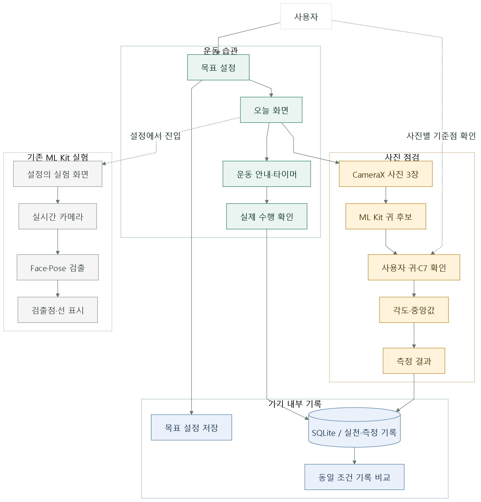

# 목 자세 코치 진행 요약

캡스톤디자인 5조 | 작성 2026-10-10 | 실촬영 결과 기준 2026-09-30

## 1. 현재 어디까지 만들었나요?

운동을 꾸준히 기록하고 정기적으로 옆모습 사진을 찍어 자세 수치를 비교하는 Android 앱입니다. 갤럭시 탭에서 사진 3장 촬영, 기준점 확인, 각도 계산과 기록 저장까지 동작을 확인했습니다. 현재는 개발용 앱이며 측정 정확도와 운동 효과, 여러 스마트폰 사용성은 검증이 남아 있습니다.

### 서비스의 사용 흐름

목표 설정 → 첫 사진 점검 → 운동과 실천 기록 → 중간·마지막 사진 점검 → 같은 촬영 조건의 이전 수치와 비교.

### 된 것과 남은 것

| 구분 | 현재 상태 |
| --- | --- |
| 확인 완료 | 갤탭 설치·실행, 사진 3장, 각도·중앙값 표시, 저장·재실행 유지 |
| 구현·검증 필요 | 운동 목표·타이머·일별 기록, 촬영 품질 검사, 중단·회전 처리 |
| 아직 미구현 | 최종 UI, 운동 이미지·영상, 최초 고지 동의, 출시용 배포 설정 |
| 아직 미검증 | S20 Ultra 사용성, 여러 날 기록, 기준 측정과의 오차 |
| 현재 범위 제외 | 자동 C7 검출, 각도별 등급·운동 처방, 회복 기간 예측 |

### 주요 작업 기록

| 날짜 | 한 일 | 결과 |
| --- | --- | --- |
| 09.13–09.21 | 개발 환경·규칙, 검출점과 표시선 실험 | 귀·어깨 검출 문제와 보정 과제 확인 |
| 09.30 | 운동 습관과 사진 점검 중심 앱 구현 | 갤탭 촬영·저장·재실행 확인 |
| 10.03–10.04 | 진행 보고, 클래스·구조도, 디자인 지침서 | 팀 공유 자료와 UI 시안 요청 범위 정리 |
| 10.10 | 코드와 기존 실험 기록 대조 | 기능 상태 및 다음 작업 일정 정리 |

원래 필수 기능 9개 대비 평가 진행률은 61.1%입니다. 완료 3개, 부분 완료 5개, 미완료 1개에 각각 1·0.5·0점을 부여한 값입니다. 전체 과제 완료율이나 측정 정확도가 아니며, 상세 산정표는 별도 상세 보고서에 있습니다.

<!-- PAGEBREAK -->

## 2. 앱은 이렇게 동작합니다

사진의 귀 후보는 ML Kit이 제안하고, 사용자가 귀와 미리 확인한 C7 표식을 지정합니다. 앱은 각도를 계산해 숫자만 기기에 저장합니다. 운동은 안내와 타이머를 제공하고 실제 수행 확인 후 일별 기록을 남깁니다.

운동 화면과 사진 점검은 기기 내부 저장소를 공유합니다. 목표 설정은 SharedPreferences, 실천·측정 기록은 SQLite에 보관합니다. 사진은 메모리에서만 처리합니다. 기존 실시간 ML Kit 실험은 별도 화면으로 남아 있습니다.

현재 구현은 Java Android입니다. C7 자동 인식, 서버, 로그인, 클라우드 동기화는 없습니다. 첨부 구조도를 한국어로 재구성했으며 투명 배경의 SVG·PNG와 Mermaid 원본을 별도로 제공합니다.

<!-- PAGEBREAK -->

## 3. 무엇을 확인했고 무엇이 남았나요?

### 갤탭 실촬영 결과

2026년 9월 30일, 한 사용자가 갤럭시 탭 SM-T735N의 전면 카메라로 서 있는 왼쪽 옆모습을 3장 촬영했습니다. 귀와 C7을 확인한 뒤 저장했습니다.

| 첫 번째 | 두 번째 | 세 번째 | 대표값 | 최대–최소 차이 |
| --- | --- | --- | --- | --- |
| 52.5° | 55.4° | 55.7° | 중앙값 55.4° | 3.2° |

3.2도는 사진 세 장 사이의 차이입니다. 실제 자세에 대한 오차가 아니며, 전문가 기준값과 대조하지 않았습니다. 한 번의 촬영 묶음으로 정확도나 개선 효과를 판단할 수 없습니다.

| 확인 방법 | 결과 |
| --- | --- |
| 사진별 기준점 확인 | 확인 전 진행 불가, 확인 후 다음 단계 진행 |
| 저장 후 종료·재실행 | 세 각도와 촬영 조건 유지 |
| 홈 화면 가로·세로 전환 | 최근 기록 유지. 촬영 중 회전 시험은 별도 |
| 계산 검사 | 18개 통과 기록 |
| 갤탭 내부 동작 검사 | 11개 통과 기록. 참가자 수가 아님 |

### 현재 구현의 한계

- C7 위치는 사람이 먼저 확인해야 합니다. 귀 후보도 사용자 확인이 필요합니다.
- 촬영 중 미리보기 가림과 시간 간격 분산을 구현했지만, 의도적으로 유지한 자세를 완전히 탐지하지는 못합니다.
- 운동 수행은 사용자의 자기 확인입니다. 여러 날 실천과 실제 완료 기록 시험은 남아 있습니다.
- 동일 조건 비교는 앱에 저장한 좌우·전후면 등의 조건을 기준으로 합니다. 실제 거리와 조명도 맞춰야 합니다.

다음 검증은 스마트폰 사용성, 반복 촬영, 조건 변화, 수동 기준값 대조로 구분해 진행합니다. 이번 보고서는 기존 실험을 정리했으며 10월 10일 신규 실험 결과를 추가하지 않았습니다.

<!-- PAGEBREAK -->

## 4. 작업 칸반과 다음 일정

| 확인 완료 | 구현·검증 필요 | 다음 주 | 후속 예정 |
| --- | --- | --- | --- |
| 갤탭 핵심 흐름 | 운동 실천·날짜 변경 | 시안 검토 | Android UI 적용 |
| 각도·중앙값 | 촬영 예외·품질 검사 | Figma UI 제작 | 운동 콘텐츠 반영 |
| 저장·재실행 | 다른 날 기록 비교 | 클릭형 프로토타입 | S20 Ultra·측정 검증 |

### 미완료 작업의 예정 시기

| 기간 | 작업 | 완료할 결과 |
| --- | --- | --- |
| 10.12–10.18 | 시안 검토, Figma UI와 클릭형 프로토타입 | 주요 화면 연결, 팀 검토 의견 |
| 10.19–10.25 * | Android UI·운동 이미지와 영상 반영 | 확정한 화면과 콘텐츠가 동작하는 앱 |
| 10.26–10.31 * | 동의 절차·촬영 예외 보완, S20 Ultra 검증 | 모바일 사용성 확인표와 결함 수정 |
| 11.02–11.15 * | 반복 측정과 수동 기준값 대조 | 측정 데이터와 오차 분석 초안 |
| 11.16–11.29 * | 추가 기기·여러 날 기록 확인 | 기기별 결과와 시연 영상 |
| 12월 * | 결과보고서·발표·배포 준비 | 최종 결과 및 출시 준비 목록 |

* 다음 주 Figma 작업 이후의 기간은 제안 일정입니다. 자료 전달과 검증 결과에 따라 조정합니다. Figma 프로토타입은 화면 흐름 확인용이고, 카메라·분석·저장의 실제 동작은 Android에서 검증합니다.

### 추가할 내용

운동 이미지·영상은 전달 후 내용과 사용 권한을 확인해 반영합니다. 알림과 이력 그래프는 핵심 검증 후 검토할 후보입니다. Google Play 출시는 추가 목표이며 날짜는 미확정입니다. 출시 전 패키지·아이콘·서명·데이터 이전·테스트 배포를 정리해야 합니다.

### 근거와 상세 자료

이 요약은 기존 「5조 캡디 진행상황 공유」 PDF, APP_STATUS.md, 2026-10-10 확인한 앱 코드 및 Git 이력을 바탕으로 작성했습니다. [상세 보고서](PROGRESS_REPORT_2026-10-10.md)에 클래스 역할, 실제 처리 방식, 날짜별 근거와 진행률 산정표가 있습니다.
